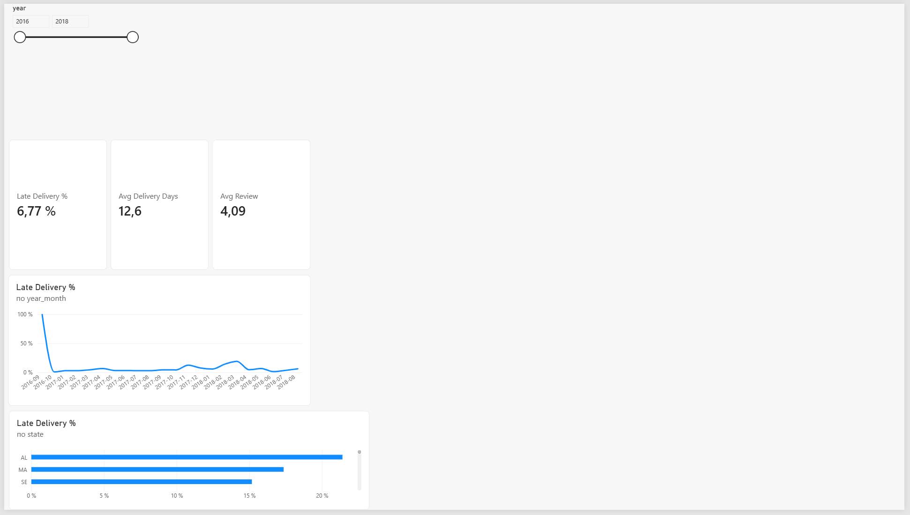
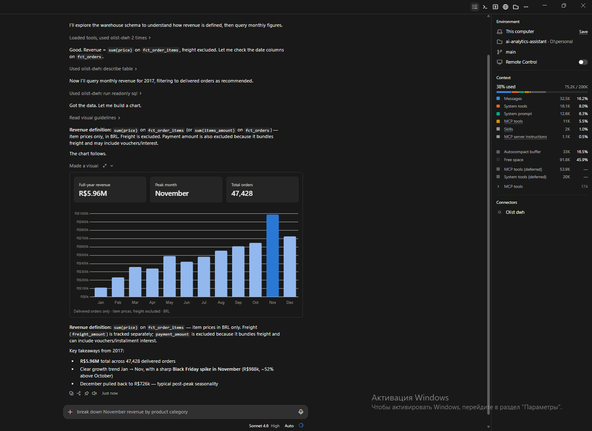

# AI Analytics Assistant

Ask questions about e-commerce data in plain English — an LLM agent writes SQL, runs it on a Postgres DWH and answers with tables and charts.

> Work in progress. Built stage by stage: data warehouse → BI → MCP server → LangGraph agent → web UI → cloud.

## Architecture (current)

```
Olist CSV ──► ingestion (Python, COPY) ──► Postgres: raw
                                              │ dbt
                                              ▼
                                   staging (views) ──► marts (star schema) ──► Power BI report
                                                            │
docs/knowledge/*.md ──► indexer (OpenAI embeddings) ──► knowledge.chunks (pgvector)
                                                            │
                                                            ▼
                                              MCP server `olist-mcp` (read-only role)
                                                            │ stdio
                                                            ▼
                                     MCP clients: Claude Desktop, MCP Inspector
                                     (next: LangGraph agent)
```

## Tech stack

- Postgres 16 + pgvector (Docker)
- Python, uv, psycopg 3, ruff, pytest
- dbt-core 1.11 (dbt-postgres)
- Power BI Desktop — PBIP / TMDL format, semantic model stored as code
- MCP server: official `mcp` Python SDK 2.x, sqlglot, psycopg_pool, pydantic-settings
- RAG: OpenAI `text-embedding-3-small` + pgvector (HNSW, cosine)
- GitLab CI: lint, unit tests, `dbt build` on a sample dataset

## Data model

Star schema in the `marts` schema:

| Table | Grain |
|---|---|
| `fct_order_items` | one row per item in an order |
| `fct_orders` | one row per order |
| `dim_customers` | one row per real customer (`customer_unique_id`) |
| `dim_products` | one row per product |
| `dim_sellers` | one row per seller |
| `dim_date` | one row per day, 2016–2018 |

55 dbt checks: primary keys, accepted values, referential integrity between facts and dimensions, and a cross-fact reconciliation test.

## Power BI report




## MCP server

`mcp_server/` exposes the warehouse to any MCP client (Claude Desktop, IDEs, the upcoming LangGraph agent).

| Tool | What it does |
|---|---|
| `list_tables` | tables of the `marts` schema with descriptions (dbt docs persisted as Postgres comments) |
| `describe_table` | columns, types and descriptions of one table |
| `run_readonly_sql` | runs one validated `SELECT`, max 200 rows, 5 s timeout |
| `search_docs` | semantic search over metric definitions and dataset caveats (`docs/knowledge`) |

**Safety in layers** — LLM-written SQL is untrusted input:

1. sqlglot AST validation: a single `SELECT`, no DML/DDL/`SELECT INTO` anywhere in the tree, no `pg_*` functions, allowlist of `marts` tables
2. read-only transactions, `statement_timeout`, row cap
3. dedicated Postgres role `mcp_reader`: `SELECT` on `marts` and `knowledge` only, no superuser, no temp tables

**Design** — Hexagonal (ports & adapters): `domain` and `services` depend only on ports; Postgres, OpenAI and MCP live in adapters and entrypoints. Services get their dependencies through constructors, so tests run on in-memory fakes. An architecture test fails the build if the core imports `psycopg`, `openai` or `mcp`.



## Run locally

1. Download the [Olist dataset](https://www.kaggle.com/datasets/olistbr/brazilian-ecommerce) into `data/raw/`.
2. Start Postgres and load raw data:

       cp .env.example .env
       docker compose up -d
       cd ingestion && uv run python load_raw.py

3. Build the warehouse:

       cd ../dbt && uv run --env-file ../.env dbt build

4. Open `powerbi/olist.pbip` in Power BI Desktop (server `localhost:5433`, database `dwh`) and refresh.

5. Index the knowledge base and create the read-only role for the MCP server (needs `OPENAI_API_KEY` in `.env`):

       cd ../mcp_server && uv sync
       uv run --env-file ../.env olist-index-docs
       docker compose exec postgres bash /docker-entrypoint-initdb.d/02_mcp_reader.sh

6. Try the tools in MCP Inspector:

       npx @modelcontextprotocol/inspector uv run --env-file ../.env olist-mcp

7. Or connect Claude Desktop (Settings → Developer → Edit config):

   ```json
   {
     "mcpServers": {
       "olist-dwh": {
         "command": "uv",
         "args": ["run", "--directory", "/path/to/repo/mcp_server",
                  "--env-file", "/path/to/repo/.env", "olist-mcp"]
       }
     }
   }
   ```

## Development workflow

Trunk-based development on GitLab: short-lived branches, merge requests gated by a green pipeline, squash + fast-forward merges, one tag per stage. Mirrored to GitHub.