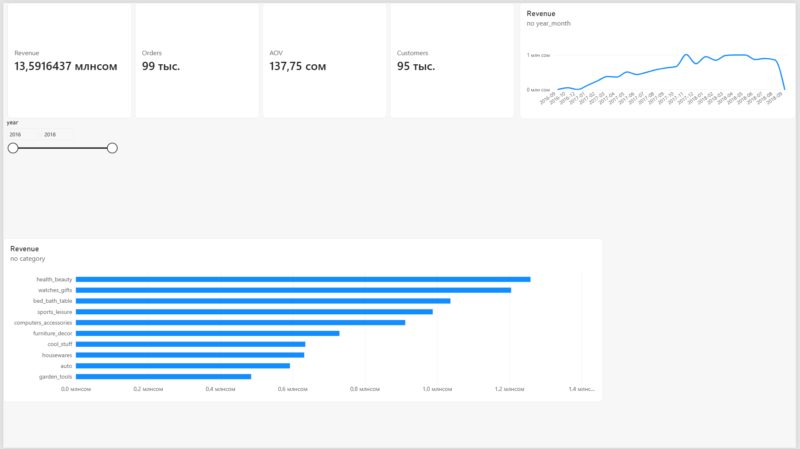

# AI Analytics Assistant

Ask questions about e-commerce data in plain English — an LLM agent writes SQL, runs it on a Postgres DWH and answers with tables and charts.

> Work in progress. Built stage by stage: data warehouse → BI → MCP server → LangGraph agent → web UI → cloud.

## Architecture (current)

```
Olist CSV ──► ingestion (Python, COPY) ──► Postgres: raw
                                              │ dbt
                                              ▼
                                   staging (views) ──► marts (star schema)
                                                            │
                                                            ▼
                                                      Power BI report
```

## Tech stack

- Postgres 16 + pgvector (Docker)
- Python, uv, psycopg 3, ruff, pytest
- dbt-core 1.11 (dbt-postgres)
- Power BI Desktop — PBIP / TMDL format, semantic model stored as code
- GitLab CI: lint, unit tests, `dbt build` on a sample dataset

## Data model

Star schema in the `marts` schema:

| Table | Grain |
|---|---|
| `fct_order_items` | one row per item in an order |
| `fct_orders` | one row per order |
| `dim_customers` | one row per real customer (`customer_unique_id`) |
| `dim_products` | one row per product |
| `dim_sellers` | one row per seller |
| `dim_date` | one row per day, 2016–2018 |

55 dbt checks: primary keys, accepted values, referential integrity between facts and dimensions, and a cross-fact reconciliation test.

## Power BI report




## Run locally

1. Download the [Olist dataset](https://www.kaggle.com/datasets/olistbr/brazilian-ecommerce) into `data/raw/`.
2. Start Postgres and load raw data:

       cp .env.example .env
       docker compose up -d
       cd ingestion && uv run python load_raw.py

3. Build the warehouse:

       cd ../dbt && uv run --env-file ../.env dbt build

4. Open `powerbi/olist.pbip` in Power BI Desktop (server `localhost:5433`, database `dwh`) and refresh.

## Development workflow

Trunk-based development on GitLab: short-lived branches, merge requests gated by a green pipeline, squash + fast-forward merges, one tag per stage. Mirrored to GitHub.